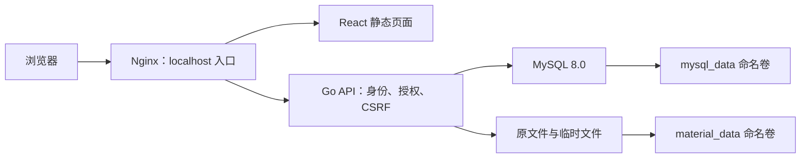

# CampusClaw 迭代 1：项目成果与智能体交接报告

更新日期：2026-09-28。仓库：`E:\sspku-my-course-demo`。变更：`add-auth-rbac-class-knowledge`。

## 1. 项目介绍

CampusClaw 是一个面向课堂演示的班级教学资料管理应用。教师和学生使用账号密码登录；教师上传 TXT/Markdown，系统保存原文件、提取文本并写入知识库记录，同班成员可以立即浏览和下载，其他班级无法读取。

当前完成了从身份认证、服务端授权、文件与数据库一致性，到 React 页面、容器部署和恢复验收的完整流程。OpenSpec 的 25 项任务全部完成，42 个 Scenario 均有对应验收证据。这里的“知识库”是材料及提取文本的关系型持久化，目前没有问答、聊天、向量检索或模型调用。

## 2. 使用了什么技术

| 层次 | 已采用技术 | 用途 |
| --- | --- | --- |
| 后端 | Go、标准库 net/http | HTTP API、认证授权、上传、读取与存活检查 |
| 数据访问 | database/sql、go-sql-driver/mysql | 显式 SQL、参数化查询、事务、连接池；没有 ORM 自动建表 |
| 数据库 | MySQL 8.0 / InnoDB | 账号、班级、会话、材料与知识库文本 |
| 迁移 | golang-migrate、版本化 SQL | 显式 up/down schema，可重复执行 up |
| 前端 | React 18.3.1、TypeScript 5.9.3、Vite 8.3.1 | 登录、身份恢复、班级列表、教师上传、详情与下载 |
| 密码与会话 | scrypt、HMAC-SHA256、不透明 Cookie、服务端 sessions | 密码哈希、可吊销会话、可信身份 |
| 请求保护 | CSRF token、Origin / Sec-Fetch-Site 校验 | 防止跨站写请求；不依赖页面隐藏按钮授权 |
| 入口 | Nginx | 托管前端静态文件，同源转发 API 与 health |
| 部署 | Docker 多阶段构建、Docker Compose | mysql/api/nginx 三服务、两个命名卷 |
| 验证 | Go test、真实 MySQL、Playwright、PowerShell 容器验收 | 单元、集成、浏览器、权限矩阵、故障与持久化验证 |
| 过程管理 | OpenSpec、Git | 先规约后实现、逐项 verify、场景证据与版本留存 |

Go module 声明 `go 1.26.0`，实际本机验证使用 Go 1.27.1，镜像使用 golang:1.27-alpine。依赖准确版本以 `backend/go.mod`、`frontend/package-lock.json` 为准。

## 3. 已完成的八组工作

| 任务组 | 完成内容与主要结果 |
| --- | --- |
| T1 配置与模型 | 建立后端骨架、环境配置、显式五表迁移、唯一/非空/外键约束、配置示例与忽略规则 |
| T2 登录与会话 | CSRF 引导、账号密码登录、会话替换、身份查询、登出吊销；旧 Cookie 重放被拒绝 |
| T3 验收数据 | A/B 两班和三个账号；A 班 TXT/MD 待上传样本、B 班完整种子；串行重复初始化不改密码或复制数据 |
| T4 班级隔离 | 从数据库身份取得角色/班级，所有材料读取受保护，双向跨班详情和下载同形 404 |
| T5 上传入库 | 文件校验、随机存储键、原文件保存、文本提取、两表事务；确定失败补偿和未知提交核实 |
| T6 页面 | 登录/登出、刷新恢复、材料列表、教师上传、详情及附件；503 保留身份，脚本文本转义 |
| T7 容器运行 | 三服务构建部署、仅 localhost 入口、独立数据库就绪检查、卷持久化、备份恢复演练 |
| T8 综合验收 | 经 Nginx 三账号矩阵、原会话与过期会话重建验证、两表/文件哈希不变、42 场景证据映射 |

## 4. 架构与核心数据模型

只有 Nginx 发布宿主机端口，默认 `127.0.0.1:8080`。API/MySQL 在内部网络运行；Nginx 不挂载材料卷，下载必须通过 API 授权。

| 表 | 内容与关键约束 |
| --- | --- |
| classes | 班级 ID 与名称 |
| users | 唯一 username、password_hash、teacher/student 角色、class_id 外键；一个账号只属于一个班级 |
| sessions | 会话 ID 的 HMAC 摘要、可空 user_id、创建/到期时间、CSRF 摘要及期限；匿名会话不能读材料 |
| materials | 非空且有索引的 class_id、uploader_id、original_name、storage_key、size、seed/upload 来源、created_at |
| knowledge_entries | 唯一 material_id、非空且有索引的 class_id、extracted_text；复合外键确保与材料班级一致 |

另有迁移工具管理的 `schema_migrations`。没有讲义、作业、助手、技能等额外占位表。

## 5. 后续智能体必须保留的行为合同

- **权限来源**：每次请求通过有效会话关联 users，取得当前角色和班级。忽略请求中的角色和 class_id；教师指定另一班级上传仍归自己班级。学生直接请求上传必须 403。
- **会话**：登录后固定八小时，不滑动续期。Cookie 只包含随机 ID；数据库保存 HMAC 摘要。登录替换旧会话，登出删除会话。重建保留数据库和原 SESSION_SECRET 时未过期 Cookie 仍有效。
- **CSRF**：先 GET /api/csrf，再以 X-CSRF-Token 写请求；匿名会话三十分钟，token 最长三十分钟且不超过会话剩余时间。再次获取或登录换会话后旧 token 失效。前端不将 token/会话存入 Web Storage。
- **文件合同**：单个 txt/md，大小写不敏感，UTF-8 可带 BOM，最大 5 MiB。Markdown 按源码提取，不渲染 HTML。原文件保留 BOM，文本提取去掉首个 BOM。原文件以附件返回。
- **一致性**：文件系统与 MySQL 不是一个原子事务。确定失败回滚并尝试一次文件补偿；提交结果未知时保留文件、返回安全错误并等待核实。恢复/清理失败时业务未就绪，需人工修复后重启，不持续自动重试。
- **重试语义**：事务已成功但响应丢失时数据仍有效；再次上传是独立上传，可能产生第二份材料，没有幂等键。
- **错误语义**：未登录 401、权限/CSRF 403、输入 400/413、跨班或不存在同形 404、内部文件错误 500、依赖不可用 503。身份因查库失败无法判定时直接 503，不能误报未登录。非法文件类型为 400，415 只是合同中的保留类别。
- **存活与就绪**：GET /health 只表示 Go 进程可响应，不查询数据库、会话或磁盘。数据库停机时它仍为 200，业务接口为 503；Go 停机时 Nginx 返回 JSON 503。
- **安全与配置**：密码只存带盐 scrypt 哈希。密钥、数据库密码和种子密码来自环境，不写前端或源码。课堂 HTTP Cookie 为 HttpOnly/SameSite=Lax；直接 HTTPS 时 Secure，生产 TLS 终止方案尚未纳入本迭代。

## 6. 九个接口

| 方法与路径 | 成功返回 |
| --- | --- |
| GET /health | 200，status=ok；匿名可用 |
| GET /api/csrf | 200，csrf_token；匿名可引导 |
| POST /api/login | 200，user 对象及新 Cookie |
| GET /api/me | 200，id/username/role/class_id |
| POST /api/logout | 200，ok=true，吊销并清 Cookie |
| POST /api/materials | 201，material_id；仅教师，multipart 字段 file |
| GET /api/materials | 200，items 数组；仅本班，无分页/total |
| GET /api/materials/{id} | 200，id/title/class_id/created_at/text |
| GET /api/materials/{id}/file | 200，原始二进制附件 |

JSON 错误固定只有 error/message。列表元素为 id/title/class_id/created_at；created_at 是 UTC RFC3339，页面按浏览器时区显示。知识库没有独立公开读取 API。

## 7. 运行与数据准备

完整操作以 [部署说明](../deploy/README.md) 为准。Docker Desktop 使用 Linux containers；初始化顺序为构建 → MySQL 就绪 → migrate → seed → seed-materials → API/Nginx。

Compose 必需 SESSION_SECRET、DB_PASSWORD、MYSQL_ROOT_PASSWORD；初始化另需 SEED_TEACHER_A_PASSWORD、SEED_STUDENT_A1_PASSWORD、SEED_STUDENT_B1_PASSWORD。Compose 的 DB_NAME/DB_USER 默认 campusclaw；原生 Go 的配置要求见 [配置文档](../backend/CONFIGURATION.md)。没有默认账号密码。

| 账号 | 身份 | 预期材料 |
| --- | --- | --- |
| teacher_a | A 班教师 | 上传并读取 A 班资料 |
| student_a1 | A 班学生 | 读取 A 班资料，不可上传 |
| student_b1 | B 班学生 | 只读取 B 班种子，不可上传 |

样本标记为 CLASS_A_TXT_ONLY、CLASS_A_MD_ONLY、CLASS_B_SEED_ONLY。A 样本需教师实际上传，B 样本由显式初始化写入。

正常停止用 `docker compose stop`，重建用不带删除卷选项的 down/up。不要将 `down -v` 用作常规停止。重建时保留两个卷、原数据库密码和原 SESSION_SECRET。备份先停止写入，同时保存 MySQL 与材料文件，恢复两者成功后才启动 API 清理流程。

当前最近一次运行是已结束的隔离验收，测试容器已停止、测试卷保留；不能据此认为默认应用已在 localhost 持续运行。

## 8. 验证结果与证据边界

- OpenSpec：25/25 任务，apply 状态 all_done，严格 validate 通过。
- 最终真实 Docker 验收：三账号双向隔离、伪造参数、匿名/学生上传拒绝、原 Cookie 重建、过期 Cookie 401、文本与文件哈希、初始化幂等均通过。
- Go 回归、真实 MySQL 约束/事务测试、浏览器交互、镜像构建、备份恢复均有记录。
- 42 个 Scenario 已逐项映射。浏览器交互证据使用 Vite 同源代理；Nginx 验收使用实际 HTTP/容器。
- 响应丢失和提交确认丢失通过应用边界注入测试，未做物理断网/断电实验；前端部分 503 使用响应拦截注入，数据库停机恢复另有真实 MySQL 测试。
- 没有生产高可用、压力容量或公网 TLS 终止验收；“完成”指当前评审范围。

核心证据：[最终验收](../deploy/VERIFY-T8.md)、[逐场景映射](../deploy/SCENARIO-EVIDENCE.md)、[部署与恢复](../deploy/VERIFY-T7.md)、[浏览器验收](../frontend/VERIFY-T6.md)、[上传故障验收](../backend/VERIFY-T5.md)。

## 9. 给接手智能体的阅读顺序

1. README、根目录 AGENTS.md 与本报告。
2. `openspec/changes/add-auth-rbac-class-knowledge/` 的 proposal/design/specs/tasks；早期段落中的“仅文档/尚未实现”属于阶段快照，当前完成状态以 tasks、实现和验收记录交叉核实。
3. `backend/internal/httpapi/` 的身份/会话、materials、upload、upload_recovery；`backend/migrations/` 的显式 SQL。
4. `frontend/src/` 与前端 README；`compose.yaml`、`deploy/`。
5. 修改前先确定需求是否在规约范围；新增需求先进入 change。按任务执行 verify 后勾选，不能把文档生成当作业务实现。

范围外：问答、聊天、作业流程、注册找回、SSO、课表练习、向量检索、模型调用、生产高可用；并发初始化、种子失败补偿、登录限流、分页、总配额、持续清理失败自动重试和上传幂等键也未实现。

## 10. 可直接转交给其他智能体的简述

我有一个已完成首轮实现与验收的 CampusClaw 项目，仓库在 E:\sspku-my-course-demo。它使用 Go net/http + database/sql、MySQL 8.0、React 18 TypeScript Vite 和 Nginx，通过 Docker Compose 部署。教师和学生账号密码登录，采用 scrypt 密码哈希、服务端 sessions、不透明 Cookie 和 CSRF；角色和班级只取自数据库身份。教师可上传最大 5 MiB 的 UTF-8 TXT/Markdown，系统保存原文件并将材料与提取文本同步写入两张关联表，同班成员可读，跨班返回 404，学生上传 403。已经实现页面、迁移、种子、文件补偿与启动恢复、两个数据卷、备份恢复，25 项 OpenSpec 任务完成、42 个 Scenario 有证据。知识库目前只是文本及关联记录，不含 AI 问答或向量检索。接手请先读本报告、AGENTS.md、当前 change 和 deploy/VERIFY-T8.md，遵守先规约后实现，不扩大非目标范围，也不要把已结束的隔离测试误认为应用正在运行。
